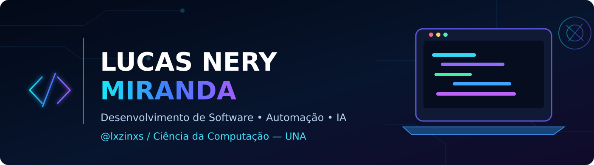
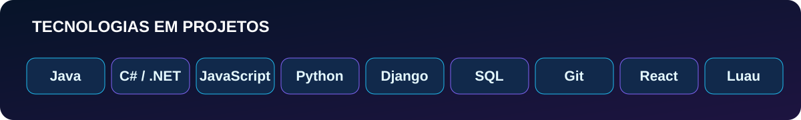

**Estudante de Ciência da Computação | Desenvolvimento de Software | Automação | IA local**

## 👨‍💻 Sobre mim

Sou **Lucas Nery Miranda**, estudante de **Bacharelado em Ciência da Computação no Centro Universitário UNA (Contagem/MG)**, em busca de oportunidades de **estágio em tecnologia e desenvolvimento de software**. Aprendo construindo: mantenho repositórios de exercícios, aplicações web, sistemas de gestão, automação e protótipos de jogos.

Tenho prática em **Java, C#, JavaScript, Python, HTML/CSS, SQL, Git e GitHub** e exploro ferramentas como **.NET, Django, PostgreSQL, React/TypeScript, Ollama e Luau** em projetos. Gosto de resolver problemas, investigar bugs, documentar decisões e colaborar com equipes.

## 🚀 Projetos públicos em destaque

| Projeto | O que demonstra | Tecnologias |
| :--- | :--- | :--- |
| [**Calculadora Científica A3**](https://github.com/vtvpc/Calculadora-Cientifica-A3) | Projeto acadêmico **colaborativo**. Minha atuação envolveu correção de bugs, revisão/expansão de funcionalidades matemáticas, manutenção e apoio à documentação e apresentação. | HTML, CSS, JavaScript, Math.js |
| [**DevGamificado**](https://github.com/lxzinxs/Projeto_A3) | Plataforma educacional de programação com desafios, XP, conquistas, ranking e armazenamento local. | HTML, CSS, JavaScript, localStorage |
| [**Cadastro de Clientes**](https://github.com/lxzinxs/Cadastro-de-Clientes) | Aplicação Java de terminal com cadastro, listagem, edição, exclusão e busca de clientes. | Java, Scanner, ArrayList |
| [**Terminal de Suporte**](https://github.com/lxzinxs/TerminalSuporte.ConsoleApp) | Protótipo de CLI em C# explorando validação, feedback visual, menus e prevenção de erros. | C#, .NET |
| [**Desafios Alura**](https://github.com/lxzinxs/Praticando_logica_alura) | Exercícios de lógica e DOM: carrinho, sorteador, jogo, ingressos e amigo secreto. | JavaScript, HTML, CSS |
| [**Calculadora em Java**](https://github.com/lxzinxs/Calculadora-em-java) | Quatro operações e proteção contra divisão por zero, com entrada pelo terminal. | Java |
| [**RPG de texto**](https://github.com/lxzinxs/RPG-de-texto-java-solo) | Projeto pessoal de aprendizado e evolução de lógica orientada a jogos. | Java |

> Também mantenho exercícios acadêmicos de algoritmos, Java, C#, usabilidade e desenvolvimento web. O histórico completo está na aba [Repositórios](https://github.com/lxzinxs?tab=repositories).

## 🧪 Projetos privados em desenvolvimento

Alguns projetos permanecem **privados** enquanto evoluem e são validados. Compartilho apenas uma visão geral, sem expor código interno:

- **EstoquePro** — sistema de gestão de estoque em Django e PostgreSQL; em desenvolvimento, ainda não homologado para venda.
- **MinhaIA** — assistente local em Python com Ollama e SQLite; evolução incremental de funcionalidades e interfaces.
- **Claude_Codex** — central de orquestração de fluxos de trabalho com agentes de programação e checkpoints Git.
- **Neryth** — RPG local construído com C#/.NET e SQLite.
- **Neryth Blox** — protótipo de MMORPG para Roblox Studio, Luau e Rojo.
- **AFTER** — MVP de rede social gamer com React, TypeScript, Tauri e integração opcional com Supabase.

## 🎓 Formação e certificações

**Bacharelado em Ciência da Computação** — Centro Universitário UNA, Contagem/MG · *em andamento*

**Alura · 10 cursos concluídos · 71 horas de carga horária estimada (2025–2026)**

| Curso | Horas | Certificado |
| :--- | ---: | :--- |
| Começando em Programação: carreira e primeiros passos | 1h | [Ver](https://cursos.alura.com.br/certificate/895bfd86-6116-46f7-90f9-9e39d97e9e9a) |
| Lógica de programação: mergulhe em programação com JavaScript | 6h | [Ver](https://cursos.alura.com.br/certificate/9a6cab2a-749c-427d-8510-b12b80673ea6) |
| Lógica de programação: explore funções e listas | 6h | [Ver](https://cursos.alura.com.br/certificate/2a57f4e2-8503-40a8-8cf6-593e37b6357a) |
| Git e GitHub: compartilhando e colaborando em projetos | 8h | [Ver](https://cursos.alura.com.br/certificate/fa17250f-d073-4e18-9558-5e3b3190cebe) |
| Lógica de programação: praticando com desafios | 8h | [Ver](https://cursos.alura.com.br/certificate/9f2de8e4-b9d2-47b3-baa7-7f1f5ecc7274) |
| Pensamento computacional: fundamentos da computação e lógica de programação | 8h | [Ver](https://cursos.alura.com.br/certificate/f6616a7b-041d-4c0a-9ccc-3c1b02b1d879) |
| Java: criando a sua primeira aplicação | 8h | [Ver](https://cursos.alura.com.br/certificate/f7fefb1f-36e9-4628-82fe-ebdb7048a895) |
| Java: aplicando a Orientação a Objetos | 10h | [Ver](https://cursos.alura.com.br/certificate/98e9128e-70cf-4072-b34a-7b7cd1f509fc) |
| Java: trabalhando com listas e coleções de dados | 8h | [Ver](https://cursos.alura.com.br/certificate/36e1d48e-7962-437c-94e6-bac66ebfb1e3) |
| HTML e CSS: ambientes de desenvolvimento, estrutura de arquivos e tags | 8h | [Ver](https://cursos.alura.com.br/certificate/fa6addd3-420d-4a83-89e5-3f7f7cc6e8f6) |

**Idiomas:** Português (nativo) · Inglês (pré-avançado, informado no perfil).

## 🤝 Vamos conversar?

Estou aberto a **estágios e oportunidades de aprendizado** em desenvolvimento de software, com interesse em back-end, full stack e automação.

📩 **E-mail:** [lucasnerym@gmail.com](mailto:lucasnerym@gmail.com) · 💼 **LinkedIn:** [lucas-nery-96b854385](https://www.linkedin.com/in/lucas-nery-96b854385/)

Perfil atualizado em novembro de 2026 · Projetos públicos e privados diferenciados para preservar o trabalho em desenvolvimento.

